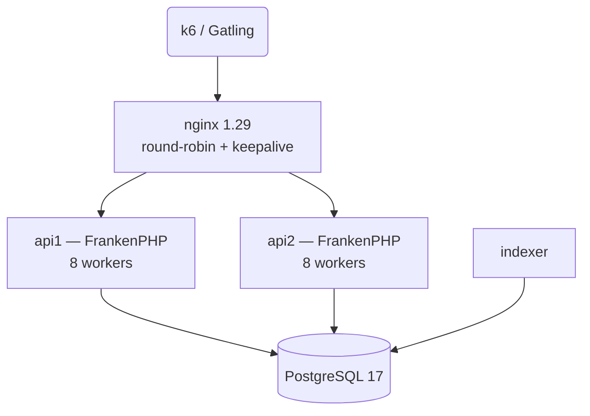

# Rinha de Backend 2023 Q3 — PHP 8.5 + FrankenPHP

Implementação da [Rinha de Backend 2023 Q3](https://github.com/zanfranceschi/rinha-de-backend-2023-q3)
em **PHP 8.5 puro** (sem framework) rodando em modo worker no **FrankenPHP**, com
**PostgreSQL 17**.

## Resultado

| métrica | valor |
|---|---|
| **registros criados (perfil oficial, 205 s)** | **46.431** |
| p99 geral | **2,78 ms** |
| p99 de criação | 2,87 ms |
| p99 de busca | 3,94 ms |
| iterações perdidas pelo k6 | **0** |
| requisições com erro | 0 de 114.847 |
| banco | PostgreSQL 17 |

## Arquitetura



Cada worker do FrankenPHP sobe uma vez, abre **uma conexão PDO** e deixa os
statements preparados. O loop `frankenphp_handle_request()` entrega cada request
a esse estado já aquecido: não há handshake TCP, autenticação nem parse/plan de
SQL por request — que é onde implementações PHP "comuns" perdem a maior parte do
tempo.

## Endpoints

| método | rota | sucesso | erro |
|---|---|---|---|
| `POST` | `/pessoas` | `201` + `Location: /pessoas/:uuid` | `422` inválido/duplicado, `400` sintaticamente inválido |
| `GET` | `/pessoas/:id` | `200` com o JSON | `404` se não existe |
| `GET` | `/pessoas?t=termo` | `200` com lista (até 50) | `400` se `t` ausente |
| `GET` | `/contagem-pessoas` | `200` texto puro | — |

A busca é case-insensitive e cobre `apelido`, `nome` e cada elemento de `stack`
separadamente: os campos são concatenados com `\x01` em `busca`, então um termo
nunca casa atravessando a fronteira entre dois atributos.

## Orçamento de recursos

| serviço | CPU | memória |
|---|---|---|
| api1 | 0.21 | 320 MB |
| api2 | 0.21 | 320 MB |
| nginx | 0.15 | 96 MB |
| db | 0.89 | 1.9 GB |
| indexer | 0.04 | 96 MB |
| **total** | **1.50** | **2.71 GB** |

Limite da Rinha: **1.5 CPU e 3.0 GB**, "para distribuir como quiser entre seus
contêineres". A soma dos limites é exatamente 1.50 CPU e 2.71 GB — dentro, com
folga de ~0.29 GB.

A distribuição não é chute: `scripts/checar-orcamento.sh` soma os limites e
falha se passar do teto, e `stress/bench.sh` mede o consumo real por container
via `cpu.stat` (incluindo `nr_throttled`, que é o que revela aperto de cota).
O banco fica com a maior fatia porque é ele que faz o trabalho real — insert com
três B-trees, índice GIN e as buscas. Medido no perfil oficial: banco 0,20 core,
APIs 0,07 cada, nginx 0,05. Na bancada de taxa constante (sem rampa) sobe para
0,40 / 0,14 / 0,10 — ainda com folga. O `indexer` é só um cliente que espera o
Postgres.

## Decisões de projeto

### 1. Busca assíncrona por marca d'água (o ganho principal)

O índice GIN trigram é obrigatório para a busca (`LIKE '%termo%'`) ser barata,
mas ele cobra caro por `INSERT` individual. Medições locais com o GIN na tabela
principal: **INSERT médio de 13,3 ms**, derrubando a escrita para ~1/3.

A solução separa o caminho de escrita do caminho de busca:

```
POST ──> pessoas          (durável, sem GIN)
             │
             │  indexer lê por seq > estado_busca.last_seq, em lotes de 500
             ▼
         pessoas_busca    (GIN trigram)
```

O `indexer` grava o lote em `pessoas_busca` **e** avança `estado_busca.last_seq`
na mesma transação. Com isso, para qualquer snapshot do Postgres:

- ou a linha está em `pessoas_busca` e `seq <= last_seq`;
- ou está acima da marca d'água — e a busca a encontra em `pessoas`.

Nunca nas duas: não há duplicata. E nunca em nenhuma, a menos que o atraso
ultrapasse o teto de 1000 linhas — nesse caso a linha aparece na busca assim que
a marca avançar. É a única janela, e ela é limitada por construção:

```sql
(SELECT resposta FROM pessoas_busca WHERE busca LIKE ? LIMIT 50)
UNION ALL
(SELECT resposta FROM pessoas
  WHERE seq > (SELECT last_seq FROM estado_busca)
    AND seq <= (SELECT last_seq FROM estado_busca) + 1000
    AND busca LIKE ? LIMIT 50)
LIMIT 50
```

#### O lote e o teto de 1000 linhas não são detalhes

Duas medições com 33k linhas reais, lote de 500, mudaram o desenho:

| caminho de indexação | custo por lote de 500 |
|---|---|
| sem GIN (só heap + PK) | 2–7 ms |
| GIN `fastupdate=off` | **123 ms → 1,3 s** (piora conforme as posting lists crescem) |
| GIN `fastupdate=on` + flush explícito | **45–90 ms** |

Com `fastupdate=off`, 600 inserts/s pedem ~1,5 core de CPU contra uma cota de
0,89. O banco é throttled, o indexador atrasa, e então entra a segunda medição:
com 4k linhas acima da marca, **cada busca custava ~2,4 ms** varrendo o atraso
inteiro. A 100 buscas/s isso é ~0,24 core a mais — que é exatamente a CPU que o
indexador precisava. Uma espiral: mais atraso → mais CPU → mais atraso.

Por isso o lote entra na *pending list* (`fastupdate=on`) e é derramado de uma vez
com `gin_clean_pending_list()`; e o ramo acima da marca d'água é limitado a 1000
linhas. O indexador drena 500 linhas por ~90 ms, então o atraso normal cabe com
folga no teto; se algum dia não couber, as linhas excedentes aparecem na busca
quando a marca avançar. A janela é de milissegundos e a busca é servida do
próprio Postgres — não há cache no caminho. O custo de busca fica limitado por
construção, não por sorte.

Uma fila com `DELETE` por lote foi tentada antes e descartada: o churn gerava
milhares de tuplas mortas, e a busca — que precisava ler a fila — passava a
varrer esse lixo. A marca d'água mantém a tabela principal *insert-only*.

### 1b. Por que não Redis

Redis na frente do indexador não resolveria o gargalo medido: a fila (heap + PK)
custa 2–7 ms por 500 linhas, enquanto o trabalho que realmente pesa — inserir no
GIN — continuaria idêntico. Trocaria 2% do custo e adicionaria um container num
orçamento que já está exatamente em 1,50 CPU, um salto volátil no caminho de
durabilidade e uma segunda fonte de verdade. `pessoas` já é o log durável: o
`POST` commita nela e o indexador lê por `seq`. Redis seria justificável se o
gargalo fosse desacoplar a API do banco (não é: `POST` p50 = 0,45 ms) ou
paralelizar consumidores (um único índice GIN não aceita escrita paralela).

### 2. Resposta serializada na escrita

O JSON de resposta é montado no `POST` e guardado na coluna `resposta`. `GET` e
busca escrevem esse texto direto no socket, sem `json_encode` por request.

### 3. UUIDv7

A PK é um UUID v7 gerado em PHP: ordenado pelo tempo, preserva a localidade do
B-tree. UUID v4 aleatório fragmentaria o índice.

### 4. Postgres

`synchronous_commit=off` (o WAL vai para disco em poucos ms, mas o `POST` não
espera o fsync — a regra exige persistência *eventual* em disco),
`wal_level=minimal`, `jit=off`, checkpoints espaçados.

## Estrutura do projeto

```
src/
  worker.php       loop do FrankenPHP (worker mode)
  App.php          rotas, validação, UUIDv7, resposta pré-serializada
  Repository.php   PDO, statements preparados, insert/get/busca/count
  indexer.php      drena pessoas -> pessoas_busca por marca d'água
db/init.sql        schema, índice GIN e parâmetros de autovacuum
docker/            Caddyfile e php.ini usados pela imagem
Dockerfile         imagem da API (FrankenPHP + extensões PHP)
nginx.conf         round-robin + keepalive
docker-compose.yml        entrega: imagens públicas, porta 9999
docker-compose.build.yml  build local da imagem
docker-compose.local.yml  porta 19999 (a 9999 está ocupada nesta máquina)
scripts/           checagem de orçamento e diagnóstico do banco
stress/            k6 replicando o perfil oficial + gerador de payloads
resultados/        saída do k6 do perfil oficial
```

## Como rodar

### Desenvolvimento local

A porta 9999 desta máquina está ocupada por outro stack, por isso o override
local expõe **19999**. O `docker-compose.yml` de entrega continua na 9999.

```bash
docker compose \
  -f docker-compose.yml \
  -f docker-compose.build.yml \
  -f docker-compose.local.yml \
  up -d --build

curl -s localhost:19999/contagem-pessoas
```

### Entrega / produção

O `docker-compose.yml` **não constrói nada** — a Rinha exige imagens públicas.
Publique a imagem e aponte para ela:

```bash
export RINHA_API_IMAGE=seu-usuario/rinha-php85:latest
docker compose up -d
```

### Teste de stress

O perfil em `stress/rinha.js` replica o `RinhaBackendSimulation.scala` oficial:
mesmas taxas, mesmas rampas, mesmo feeder circular e mesma checagem de
consistência (todo `201` é seguido de `GET` no `Location`).

```bash
# perfil oficial completo (205 s)
PROFILE=full ./stress/bench.sh

# bancada: taxa constante para achar o gargalo
PROFILE=bench POST_RATE=600 SEARCH_RATE=100 INVALID_RATE=40 DURATION=90s \
  ./stress/bench.sh
```

`stress/bench.sh` mede a CPU de cada container lendo `cpu.stat` do cgroup
**direto do host**: mostra a CPU real (em cores), `nr_throttled`/`throttled_usec`
— que revelam quando um container bateu na cota e ficou congelado, a causa típica
de rabo de p99 — e a CPU do host inteiro, para separar gargalo do stack de ruído
externo.

Para ver o mecanismo interno do banco durante a carga (backends ativos, eventos
de espera, atraso do indexador, texto das queries que saturaram):

```bash
./scripts/diagnostico-db.sh 60 /tmp/opencode/diag.log
```

> Esse script usa `docker compose exec db psql`, que roda **dentro** do container
> do banco e consome a cota dele. Use-o para entender o mecanismo, não para medir
> CPU — para isso existe o `bench.sh`. Os deltas são normalizados pelo tempo real
> entre amostras justamente porque, com o banco saturado, cada `exec` demora.

### Verificar o orçamento de CPU/memória

```bash
./scripts/checar-orcamento.sh
```

Soma os `deploy.resources.limits` de todos os serviços e falha se passar de
1.5 CPU ou 3 GB.

## Conformidade com as regras

| regra | situação |
|---|---|
| 4 endpoints com os status corretos | ✅ |
| busca contida em `apelido`, `nome` e/ou `stack`, case-insensitive, até 50 | ✅ |
| banco entre Postgres/MySQL/MongoDB | ✅ PostgreSQL 17 |
| docker-compose na porta 9999 | ✅ (`docker-compose.yml`) |
| 2 instâncias da API + 1 load balancer | ✅ |
| balanceamento round-robin | ✅ (default do nginx) |
| 1.5 CPU / 3 GB | ✅ 1.50 CPU / 2.71 GB |
| registros persistidos em disco | ✅ `pessoas` é gravada de forma síncrona no WAL |
| `contagem-pessoas` sem cache | ✅ `SELECT count(*)` direto |
| imagens públicas, sem build | ✅ `docker-compose.yml` usa só `image:` |
| licença | ✅ MIT (`LICENSE`) |

## Resultados

### Perfil oficial (205 s, rampa de 0 a 600 POST/s)

Saída completa do k6 em
[`resultados/perfil-oficial-205s.txt`](resultados/perfil-oficial-205s.txt).

| métrica | valor |
|---|---|
| pessoas criadas | **46.431** |
| POSTs rejeitados (422/400) | 8.204 |
| taxa de aceitação | 85,0% |
| requisições totais | 114.847 (560/s) |
| p99 geral | **2,78 ms** |
| p99 criação / consulta / busca | 2,87 / 2,12 / 3,94 ms |
| p99.9 / máx | 76,5 / 247,7 ms |
| iterações perdidas | **0** |
| erros HTTP | 0 |

O teto teórico do perfil é ~47,5k: 205 s de rampa, 88,3% dos payloads válidos,
menos os apelidos repetidos quando o feeder circular dá a volta. **46.431 é
97,7% desse teto** — o que falta é payload inválido, não capacidade perdida.

Para referência, o [ranking oficial](https://github.com/zanfranceschi/rinha-de-backend-2023-q3#resultado-da-etapa-final)
terminou com 44.936 registros em 1º lugar e p99 de 17,4 ms. O número acima é de
uma execução local (i5-1135G7, 8 cores, máquina compartilhada), então serve como
ordem de grandeza, não como comparação direta com a EC2 do torneio.

CPU média no período: `db` 0,20 core (de 0,89), `api1`/`api2` 0,07 (de 0,21),
`nginx` 0,05 (de 0,15). Sete eventos de throttle no banco, 1,05 s congelados em
205 s.

### Bancada de taxa constante (90 s a 600 POST/s + 100 buscas/s)

Serve para achar o gargalo, porque não tem rampa: a carga é máxima do primeiro
ao último segundo.

| métrica | valor |
|---|---|
| pessoas criadas | 45.808 (508,8/s) |
| p99 geral | 10,75 ms |
| iterações perdidas | 102 de 66.603 |

### Conferência funcional

Além do k6, uma bateria de 16 checagens cobre os contratos: `201` com
`Location`, `200` com o JSON idêntico ao criado, `404` para id inexistente e
malformado, `422` para apelido duplicado/campo nulo/data inválida, `400` para
JSON quebrado e `t` ausente, busca por `apelido`/`nome`/`stack`,
case-insensitive com Unicode (`JOSÉ ROBERTO` acha `José Roberto`), `%` tratado
como literal e termo que atravessaria a fronteira entre campos retornando vazio.
16/16 passaram.

### Evolução

| configuração | inserts (205 s) | p99 |
|---|---|---|
| GIN na tabela principal | 28.550 | 991 ms |
| fila com `DELETE`, CPU mal distribuída | 29.753 | 2,66 s |
| marca d'água + `fastupdate=on` + flush em lote + fallback limitado | **46.431** | **2,78 ms** |

Os três ganhos, em ordem de impacto:

1. **`fastupdate=on` + `gin_clean_pending_list()` por lote.** Com
   `fastupdate=off` o custo do lote de 500 crescia de 123 ms para 1,3 s, o que
   pedia ~1,5 core contra uma cota de 0,89.
2. **Fallback de busca limitado a 1000 linhas.** Sem o teto, o atraso do
   indexador virava realimentação positiva.
3. **CPU rebalanceada por medição.** O banco estava sendo throttled 160× em
   30 s; ver `stress/bench.sh` e `scripts/checar-orcamento.sh`.

> Observação: as medições são feitas numa máquina de desenvolvimento com outros
> processos disputando CPU (navegador, IDE, terminal), então os números variam
> entre execuções. O ambiente oficial da Rinha é uma EC2 dedicada.
